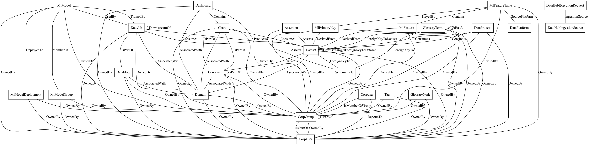

# DataHubPageModule
## Aspects

### dataHubPageModuleProperties
The main properties of a DataHub page module
<details>
<summary>Schema</summary>

```javascript
{
  "type": "record",
  "Aspect": {
    "name": "dataHubPageModuleProperties"
  },
  "name": "DataHubPageModuleProperties",
  "namespace": "com.linkedin.module",
  "fields": [
    {
      "type": "string",
      "name": "name",
      "doc": "The display name of this module"
    },
    {
      "Searchable": {
        "fieldType": "KEYWORD"
      },
      "type": {
        "type": "enum",
        "symbolDocs": {
          "ASSET_COLLECTION": "A module with a collection of assets",
          "DOMAINS": "Module displaying the top domains",
          "HIERARCHY": "A module displaying a hierarchy to navigate",
          "LINK": "Link type module",
          "OWNED_ASSETS": "Module displaying assets owned by a user",
          "RICH_TEXT": "Module containing rich text to be rendered"
        },
        "name": "DataHubPageModuleType",
        "namespace": "com.linkedin.module",
        "symbols": [
          "LINK",
          "RICH_TEXT",
          "ASSET_COLLECTION",
          "HIERARCHY",
          "OWNED_ASSETS",
          "DOMAINS"
        ],
        "doc": "Enum containing the types of page modules that there are"
      },
      "name": "type",
      "doc": "The type of this module - the purpose it serves"
    },
    {
      "type": {
        "type": "record",
        "name": "DataHubPageModuleVisibility",
        "namespace": "com.linkedin.module",
        "fields": [
          {
            "Searchable": {
              "fieldType": "KEYWORD"
            },
            "type": {
              "type": "enum",
              "symbolDocs": {
                "GLOBAL": "This module is discoverable and can be used by any user on the platform",
                "PERSONAL": "This module is used for individual use only"
              },
              "name": "PageModuleScope",
              "namespace": "com.linkedin.module",
              "symbols": [
                "PERSONAL",
                "GLOBAL"
              ]
            },
            "name": "scope",
            "doc": "Audit stamp for when and by whom this module was created"
          }
        ],
        "doc": "Info about the visibility of this module"
      },
      "name": "visibility",
      "doc": "Info about the visibility of this module"
    },
    {
      "type": {
        "type": "record",
        "name": "DataHubPageModuleParams",
        "namespace": "com.linkedin.module",
        "fields": [
          {
            "type": [
              "null",
              {
                "type": "record",
                "name": "LinkModuleParams",
                "namespace": "com.linkedin.module",
                "fields": [
                  {
                    "java": {
                      "class": "com.linkedin.common.urn.Urn"
                    },
                    "type": "string",
                    "name": "linkUrn"
                  }
                ]
              }
            ],
            "name": "linkParams",
            "default": null,
            "doc": "The params required if the module is type LINK"
          },
          {
            "type": [
              "null",
              {
                "type": "record",
                "name": "RichTextModuleParams",
                "namespace": "com.linkedin.module",
                "fields": [
                  {
                    "type": "string",
                    "name": "content"
                  }
                ]
              }
            ],
            "name": "richTextParams",
            "default": null,
            "doc": "The params required if the module is type RICH_TEXT"
          }
        ],
        "doc": "The specific parameters stored for a module"
      },
      "name": "params",
      "doc": "The specific parameters stored for this module"
    },
    {
      "Searchable": {
        "/actor": {
          "fieldName": "createdBy",
          "fieldType": "URN"
        },
        "/time": {
          "fieldName": "createdAt",
          "fieldType": "DATETIME"
        }
      },
      "type": {
        "type": "record",
        "name": "AuditStamp",
        "namespace": "com.linkedin.common",
        "fields": [
          {
            "type": "long",
            "name": "time",
            "doc": "When did the resource/association/sub-resource move into the specific lifecycle stage represented by this AuditEvent."
          },
          {
            "java": {
              "class": "com.linkedin.common.urn.Urn"
            },
            "type": "string",
            "name": "actor",
            "doc": "The entity (e.g. a member URN) which will be credited for moving the resource/association/sub-resource into the specific lifecycle stage. It is also the one used to authorize the change."
          },
          {
            "java": {
              "class": "com.linkedin.common.urn.Urn"
            },
            "type": [
              "null",
              "string"
            ],
            "name": "impersonator",
            "default": null,
            "doc": "The entity (e.g. a service URN) which performs the change on behalf of the Actor and must be authorized to act as the Actor."
          },
          {
            "type": [
              "null",
              "string"
            ],
            "name": "message",
            "default": null,
            "doc": "Additional context around how DataHub was informed of the particular change. For example: was the change created by an automated process, or manually."
          }
        ],
        "doc": "Data captured on a resource/association/sub-resource level giving insight into when that resource/association/sub-resource moved into a particular lifecycle stage, and who acted to move it into that specific lifecycle stage."
      },
      "name": "created",
      "doc": "Audit stamp for when and by whom this template was created"
    },
    {
      "Searchable": {
        "/time": {
          "fieldName": "lastModifiedAt",
          "fieldType": "DATETIME"
        }
      },
      "type": "com.linkedin.common.AuditStamp",
      "name": "lastModified",
      "doc": "Audit stamp for when and by whom this template was last updated"
    }
  ],
  "doc": "The main properties of a DataHub page module"
}
```
</details>

## Relationships

### Incoming
These are the relationships stored in other entity's aspects
- ContainedIn

   - DataHubPageTemplate via `dataHubPageTemplateProperties.rows`
## [Global Metadata Model](https://github.com/datahub-project/static-assets/raw/main/imgs/datahub-metadata-model.png)

