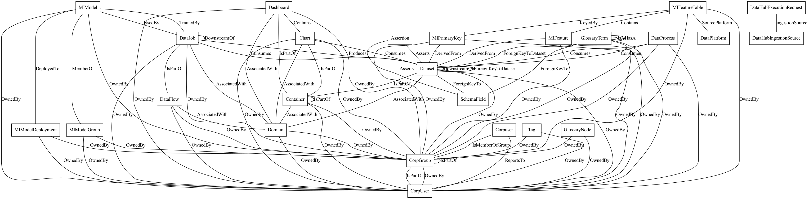

# DataHubPageTemplate
## Aspects

### dataHubPageTemplateProperties
The main properties of a DataHub page template
<details>
<summary>Schema</summary>

```javascript
{
  "type": "record",
  "Aspect": {
    "name": "dataHubPageTemplateProperties"
  },
  "name": "DataHubPageTemplateProperties",
  "namespace": "com.linkedin.template",
  "fields": [
    {
      "Relationship": {
        "/*/modules/*": {
          "entityTypes": [
            "dataHubPageModule"
          ],
          "name": "ContainedIn"
        }
      },
      "type": {
        "type": "array",
        "items": {
          "type": "record",
          "name": "DataHubPageTemplateRow",
          "namespace": "com.linkedin.template",
          "fields": [
            {
              "type": {
                "type": "array",
                "items": "string"
              },
              "name": "modules",
              "doc": "The modules that exist in this template row"
            }
          ],
          "doc": "A row of modules contained in a template"
        }
      },
      "name": "rows",
      "doc": "The rows of modules contained in this template"
    },
    {
      "type": {
        "type": "record",
        "name": "DataHubPageTemplateSurface",
        "namespace": "com.linkedin.template",
        "fields": [
          {
            "Searchable": {
              "fieldType": "KEYWORD"
            },
            "type": {
              "type": "enum",
              "symbolDocs": {
                "HOME_PAGE": "This template applies to what to display on the home page for users."
              },
              "name": "PageTemplateSurfaceType",
              "namespace": "com.linkedin.template",
              "symbols": [
                "HOME_PAGE"
              ]
            },
            "name": "surfaceType",
            "doc": "Where exactly is this template being used"
          }
        ],
        "doc": "Info about the surface area of the product that this template is deployed in"
      },
      "name": "surface",
      "doc": "Info about the surface area of the product that this template is deployed in"
    },
    {
      "type": {
        "type": "record",
        "name": "DataHubPageTemplateVisibility",
        "namespace": "com.linkedin.template",
        "fields": [
          {
            "Searchable": {
              "fieldType": "KEYWORD"
            },
            "type": {
              "type": "enum",
              "symbolDocs": {
                "GLOBAL": "This template is used across users",
                "PERSONAL": "This template is used for individual use only"
              },
              "name": "PageTemplateScope",
              "namespace": "com.linkedin.template",
              "symbols": [
                "PERSONAL",
                "GLOBAL"
              ]
            },
            "name": "scope",
            "doc": "The scope of this template and who can use/see it"
          }
        ],
        "doc": "Info about the visibility of this template"
      },
      "name": "visibility",
      "doc": "Info about the visibility of this template"
    },
    {
      "Searchable": {
        "/actor": {
          "fieldName": "createdBy",
          "fieldType": "URN"
        },
        "/time": {
          "fieldName": "createdAt",
          "fieldType": "DATETIME"
        }
      },
      "type": {
        "type": "record",
        "name": "AuditStamp",
        "namespace": "com.linkedin.common",
        "fields": [
          {
            "type": "long",
            "name": "time",
            "doc": "When did the resource/association/sub-resource move into the specific lifecycle stage represented by this AuditEvent."
          },
          {
            "java": {
              "class": "com.linkedin.common.urn.Urn"
            },
            "type": "string",
            "name": "actor",
            "doc": "The entity (e.g. a member URN) which will be credited for moving the resource/association/sub-resource into the specific lifecycle stage. It is also the one used to authorize the change."
          },
          {
            "java": {
              "class": "com.linkedin.common.urn.Urn"
            },
            "type": [
              "null",
              "string"
            ],
            "name": "impersonator",
            "default": null,
            "doc": "The entity (e.g. a service URN) which performs the change on behalf of the Actor and must be authorized to act as the Actor."
          },
          {
            "type": [
              "null",
              "string"
            ],
            "name": "message",
            "default": null,
            "doc": "Additional context around how DataHub was informed of the particular change. For example: was the change created by an automated process, or manually."
          }
        ],
        "doc": "Data captured on a resource/association/sub-resource level giving insight into when that resource/association/sub-resource moved into a particular lifecycle stage, and who acted to move it into that specific lifecycle stage."
      },
      "name": "created",
      "doc": "Audit stamp for when and by whom this template was created"
    },
    {
      "Searchable": {
        "/time": {
          "fieldName": "lastModifiedAt",
          "fieldType": "DATETIME"
        }
      },
      "type": "com.linkedin.common.AuditStamp",
      "name": "lastModified",
      "doc": "Audit stamp for when and by whom this template was last updated"
    }
  ],
  "doc": "The main properties of a DataHub page template"
}
```
</details>

## Relationships

### Outgoing
These are the relationships stored in this entity's aspects
- ContainedIn

   - DataHubPageModule via `dataHubPageTemplateProperties.rows`
## [Global Metadata Model](https://github.com/datahub-project/static-assets/raw/main/imgs/datahub-metadata-model.png)

